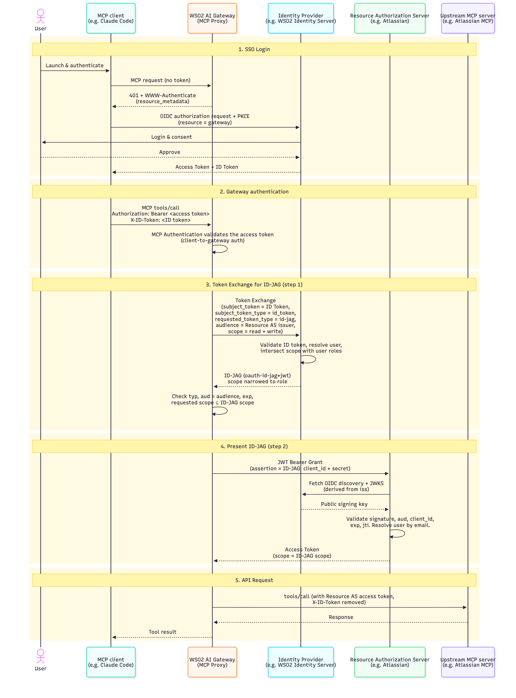
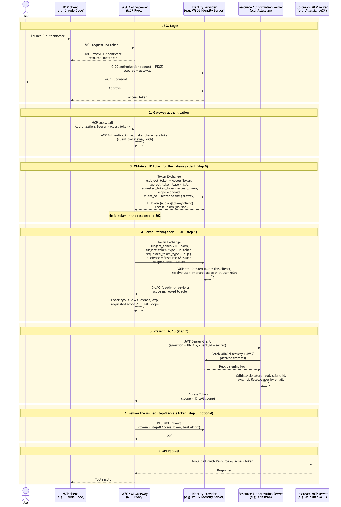

# mcp-auth-id-jag

A custom policy for the [WSO2 API Platform](https://wso2.com/api-platform/) AI
Gateway. It runs **after MCP Authentication** has validated
the client's gateway token. It obtains a **per-user access token for the
upstream MCP server** through the Identity Assertion JWT Authorization Grant
profile, [draft-ietf-oauth-identity-assertion-authz-grant](https://datatracker.ietf.org/doc/draft-ietf-oauth-identity-assertion-authz-grant/),
and injects that token before the request is forwarded. It has no
client-facing behaviour: MCP Authentication is the client-to-gateway half,
this policy is the gateway-to-upstream half.

Any Identity Provider (IdP) that issues ID-JAGs and any Resource Authorization
Server (Resource AS) that accepts them work. Where the diagrams and examples
name products (WSO2 Identity Server, Atlassian, Figma, Claude Code) they are
examples only; nothing in the policy is specific to them.

Written in Go against `github.com/wso2/api-platform/sdk/core` v0.3.5 and
compiled into the gateway image with the `ap` CLI. Policy version `v0.3.0`.

---

## 1. The assertion: an ID token, from the client or from the IdP

The ID-JAG profile [draft-ietf-oauth-identity-assertion-authz-grant](https://datatracker.ietf.org/doc/draft-ietf-oauth-identity-assertion-authz-grant/) calls the credential the gateway presents to the IdP as the
**identity assertion**. It is the `subject_token` of an RFC 8693 token
exchange whose `requested_token_type` is
`urn:ietf:params:oauth:token-type:id-jag`. Section 4.3 of the draft allows
three subject token types - ID Token, SAML Assertion, or a Refresh Token, but the
[MCP Enterprise-Managed Authorization extension](https://modelcontextprotocol.io/specification/draft/basic/authorization/enterprise-managed-authorization)
profiles only one of them - the ID token, and hence that is the only assertion this
custom policy supports:

There are 2 modes supported. What differs between the two modes is **where the ID token comes from**, chosen per policy instance
with `idTokenSource`:

- `header`: the MCP client sends the user's ID token on a header alongside the
  gateway access token.
- `exchange`: the client sends only the gateway access token. The policy
  exchanges it at the IdP, as the gateway's own client and with the `openid`
  scope, and uses the ID token that exchange returns.

Either way the rest is the same: the IdP returns an ID-JAG for the ID token,
the gateway presents it to the Resource AS in an RFC 7523 JWT-bearer grant,
and the resulting access token goes upstream.

---

## 2. Flow and configuration per ID token source

### 2.1 ID token from the client passed as a custom header (`idTokenSource: header`)

The client sends the gateway access token on `Authorization` and the user's ID
token on the header name configured under `idTokenHeader` config of the policy. 
Step 1 presents the ID token to the IdP and gets the ID-JAG, step 2
presents the ID-JAG to the Resource AS and gets the access token which the policy then injects to the tool call.
There is no step 0 in this mode.



*Source: [`docs/id-jag-flow-id-token.mmd`](docs/id-jag-flow-id-token.mmd)*

**Configuration for the header flow**

- `idTokenSource: header`
- `idTokenHeader` (default `X-ID-Token`): the inbound header carrying the ID
  token. A `Bearer ` prefix is tolerated. The value must be a JWT.
- Everything in [Common configuration](#23-common-configuration).

**Prerequisites**

- The client, or the agent in front of it, must actually send the ID token on
  that header. The sign-in at the IdP therefore has to request the `openid`
  scope so an ID token is issued.
- The IdP must accept `id_token` as a subject token type for ID-JAG issuance.
- The ID token's `aud` must include the IdP client ID of the credential set the
  policy uses (spec section 4.3.3: the IdP checks the assertion's audience
  against the client authenticating the exchange). When the MCP client signs
  in with its own client ID, configure the IdP to add the gateway's client ID
  to that application's ID token audience.

A sample MCP client (web UI and terminal) that implements this contract, keeping the ID
token from its MCP sign-in and sending it on the header, is at
[id-jag-sample-mcp-client](https://github.com/DinikaSen/id-jag-sample-mcp-client).

### 2.2 ID token obtained by the gateway (`idTokenSource: exchange`)

The client sends only the gateway access token. Step 0 exchanges it at the
IdP, as the gateway's own client and with the `openid` scope. The IdP answers
with an ID token issued to that client, which is exactly the audience the
profile requires of the assertion (section 4.3.3). Step 1 presents that ID
token, step 2 presents the ID-JAG to the Resource AS, optional step 3 revokes
the access token the IdP issued alongside the ID token, then the policy
injects the result. A step 0 response without an `id_token` is a 502: the
policy never falls back to another assertion.

Why step 0 asks for an access token rather than an ID token: most
authorization servers, WSO2 Identity Server included, support
`requested_token_type` of `access_token` or `jwt` and issue the ID token in
addition when `openid` is in scope. The access token that comes with it is
never used. With `idpRevocationEndpoint` set it is revoked as soon as the
ID-JAG exists; without it, keep the gateway client's access token lifetime
short at the IdP. No refresh token is requested, and one that arrives anyway
is discarded with a warning.



*Source: [`docs/id-jag-flow-exchange.mmd`](docs/id-jag-flow-exchange.mmd)*

**Configuration for the exchange flow**

- `idTokenSource: exchange`
- `accessTokenHeader` (default `Authorization`): the inbound header carrying
  the validated gateway access token.
- `exchangeSubjectTokenType` (default `jwt`): the `subject_token_type` the IdP
  expects for that access token in step 0, `jwt` or `access_token`.
- `exchangeScopes` (default `openid`): `scope` sent in step 0. `openid` is
  always included whatever is configured.
- `idpRevocationEndpoint` (optional): the IdP's RFC 7009 endpoint. Setting it
  enables step 3. Leave it empty if the IdP has none; the unused access token
  then simply expires.
- Everything in [Common configuration](#23-common-configuration).

**Prerequisites**

- The IdP's token exchange must return an `id_token` to the gateway's client
  when `openid` is requested. WSO2 Identity Server does; Keycloak documents
  an ID token as a requested token type instead, which this policy does not
  use yet. If the IdP never issues an ID token from an exchange, every request
  is a 502 with the reason in the gateway log.
- The IdP must accept `id_token` as a subject token type for ID-JAG issuance.
- The audience requirement takes care of itself: the ID token is issued to the
  gateway's IdP client, the same client that then requests the ID-JAG.

### 2.3 Common configuration

Used by both flows.

| Parameter | Purpose |
|---|---|
| `credentialRef` | Name of the credential set in `config.toml` holding the IdP and Resource AS client credentials. See [section 4](#4-client-credentials-credentialref). |
| `idpTokenEndpoint` | IdP token endpoint, used for step 1 (and step 0 in the exchange flow). |
| `audience` | Issuer identifier of the Resource AS. Sent as `audience` in step 1 and checked against the ID-JAG's `aud`. |
| `resourceAsTokenEndpoint` | Resource AS token endpoint for step 2. |
| `idpScopes`, `idpResource` | Optional `scope` and RFC 8707 `resource` for step 1. The IdP may grant a subset of the scopes. |
| `resourceAsScopes` | Optional `scope` for step 2. Must be a subset of the ID-JAG's scope; the policy rejects anything outside it before calling the Resource AS. |
| `idpClientAuthMethod`, `resourceAsClientAuthMethod` | `client_secret_post` (default) or `client_secret_basic`, per endpoint. |
| `cacheResourceAccessToken` and friends | See [section 5](#5-what-is-cached). Off by default. |
| `headerName`, `valuePrefix` | Where and how the Resource AS access token is injected. Defaults `Authorization` and `Bearer`. |
| `tokenRequestTimeout`, `tokenRequestMaxRetries`, `defaultTokenTTL`, `proxyURL`, `tlsCaCert`, `tlsInsecureSkipVerify` | HTTP behaviour for every token-endpoint call. |

---

## 3. Choosing between the two sources

- **`header`** when the client can carry the ID token. It costs one IdP call
  per exchange and nothing unused is ever minted. It needs the client or agent
  to forward the user's ID token, which not every MCP client does, and the IdP
  must add the gateway's client ID to that client's ID token audience.
- **`exchange`** when only the gateway access token reaches the gateway, which
  is the case for most off-the-shelf MCP clients such as Claude Code. It costs one extra IdP call
  per exchange, leaves an unused access token at the IdP unless revocation is
  on, and depends on the IdP issuing ID tokens from token exchange.

Both can coexist on one gateway: the choice is per policy instance, so one MCP
API can use `header` and another `exchange`.

---

## 4. Client credentials: `credentialRef`

Secrets never go through the UI. The policy declares a `credentials` **system
parameter** that resolves from the gateway's `config.toml`, which in turn reads
every value from the environment. A policy instance picks a set by name with
`credentialRef`.

One set pairs the gateway's confidential client at the IdP with its
confidential client at **one** Resource AS. A gateway fronting several MCP
servers therefore has several sets, and each MCP API's policy instance points
at its own.

### Example: When both Atlassian and Figma behind one gateway

Two MCP servers are proxied by the same gateway, each with its own Resource AS
and its own client registration for the gateway. The IdP is the same for both,
but the IdP client may differ too, since the ID-JAG's `client_id` claim must
match the client that then authenticates at the Resource AS.

`config.toml`:

```toml
[[policy_configurations.mcp_auth_id_jag_v0.credentials]]
name                   = "atlassian"
idpClientId            = '{{ env "APIP_GW_IDJAG_ATLASSIAN_IDP_CLIENT_ID" "" }}'
idpClientSecret        = '{{ env "APIP_GW_IDJAG_ATLASSIAN_IDP_CLIENT_SECRET" "" }}'
resourceAsClientId     = '{{ env "APIP_GW_IDJAG_ATLASSIAN_RAS_CLIENT_ID" "" }}'
resourceAsClientSecret = '{{ env "APIP_GW_IDJAG_ATLASSIAN_RAS_CLIENT_SECRET" "" }}'

[[policy_configurations.mcp_auth_id_jag_v0.credentials]]
name                   = "figma"
idpClientId            = '{{ env "APIP_GW_IDJAG_FIGMA_IDP_CLIENT_ID" "" }}'
idpClientSecret        = '{{ env "APIP_GW_IDJAG_FIGMA_IDP_CLIENT_SECRET" "" }}'
resourceAsClientId     = '{{ env "APIP_GW_IDJAG_FIGMA_RAS_CLIENT_ID" "" }}'
resourceAsClientSecret = '{{ env "APIP_GW_IDJAG_FIGMA_RAS_CLIENT_SECRET" "" }}'
```

`api-platform.env` (gitignored, mode 0600, loaded by the gateway containers):

```sh
APIP_GW_IDJAG_ATLASSIAN_IDP_CLIENT_ID=...
APIP_GW_IDJAG_ATLASSIAN_IDP_CLIENT_SECRET=...
APIP_GW_IDJAG_ATLASSIAN_RAS_CLIENT_ID=...
APIP_GW_IDJAG_ATLASSIAN_RAS_CLIENT_SECRET=...
APIP_GW_IDJAG_FIGMA_IDP_CLIENT_ID=...
APIP_GW_IDJAG_FIGMA_IDP_CLIENT_SECRET=...
APIP_GW_IDJAG_FIGMA_RAS_CLIENT_ID=...
APIP_GW_IDJAG_FIGMA_RAS_CLIENT_SECRET=...
```

Policy instance on the **Atlassian MCP** API. Note **credentialRef**:

```yaml
- name: mcp-auth-id-jag
  version: v0
  params:
    idTokenSource: exchange
    credentialRef: atlassian
    idpTokenEndpoint: https://idp.example/oauth2/token
    idpRevocationEndpoint: https://idp.example/oauth2/revoke
    audience: https://auth.atlassian.com
    idpScopes: "read:jira-work write:jira-work"
    resourceAsTokenEndpoint: https://auth.atlassian.com/oauth/token
```

Policy instance on the **Figma MCP** API. Note **credentialRef**:

```yaml
- name: mcp-auth-id-jag
  version: v0
  params:
    idTokenSource: exchange
    credentialRef: figma
    idpTokenEndpoint: https://idp.example/oauth2/token
    idpRevocationEndpoint: https://idp.example/oauth2/revoke
    audience: https://www.figma.com
    idpScopes: "files:read"
    resourceAsTokenEndpoint: https://api.figma.com/v1/oauth/token
```

Same policy, same IdP, same gateway image. What differs per MCP server is the
`credentialRef`, the `audience`, the Resource AS endpoint and the scopes. The
endpoint URLs above are illustrative; use the values each Resource AS
documents.

Rules the policy enforces at load time, when the API is deployed rather than
on the first user request:

- `credentialRef` must name an existing set, or the error lists the sets that
  do exist.
- Every field of the chosen set must be non-empty, or the error names the
  field. An unset environment variable surfaces here.
- Set names must be unique.

A note on client identity: the profile says the Resource AS must reject an
ID-JAG whose `client_id` claim is not the client authenticating the JWT-bearer
request. In the common case the gateway is one client registered at both the
IdP and the Resource AS under the same id, so `idpClientId` and
`resourceAsClientId` are the same value. The policy warns at load time when
they differ but does not refuse, since some Resource ASes assign their own ids.

---

## 5. What is cached

Tokens are obtained **just in time, per request**:

- The **ID-JAG** is never cached. It is presented once to the Resource AS and
  dropped.
- The **step 0 tokens** (exchange flow) are never cached or stored. The ID
  token lives only until step 1 has used it, the access token only until step
  3 has revoked it.
- The **Resource AS access token** is cached only when
  `cacheResourceAccessToken` is `true`, which it is not by default. The cache
  is in memory, keyed by a SHA-256 of the inbound token (ID token or
  gateway token), bounded to `cacheMaxEntries`, and an entry expires at the
  earlier of the token's own `expires_in` and the inbound credential's `exp`.
  `expiryBuffer` re-exchanges a little before expiry. When the upstream answers
  with a status in `tokenPurgeStatusCodes` (default `[401]`), only that user's
  entry is purged.

With caching off every request runs the full exchange. Concurrent requests
carrying the same credential are single-flighted either way, so an MCP
client's `initialize` plus `tools/list` burst makes one exchange, not several.

---

## 6. Error mapping

| Cause | Response |
|---|---|
| Missing or malformed inbound token | 401, `WWW-Authenticate: Bearer error="invalid_token"` |
| Step 0 or 1 `invalid_grant` / `interaction_required` | 401 as above: the IdP no longer accepts the user's credential, so the MCP client signs in again |
| Step 0 without an ID token, `invalid_client`, ID-JAG fails validation, scope outside the ID-JAG, any step 2 rejection, transport failure | 502, with the step and reason in the gateway log, never the token values |

This policy never carries a `resource_metadata` pointer: client discovery is
MCP Authentication's job and has already happened by the time this runs. An
MCP Authentication failure never reaches this policy at all; that policy ends
the chain with its own 401.

Before step 2 the policy checks the ID-JAG against the profile: `typ` must be
`oauth-id-jag+jwt`, `aud` must be exactly the configured `audience`, `exp` must
be in the future, and the step 1 response's `issued_token_type` must be
`id-jag` when present. Required claims that are merely absent are logged, since
the Resource AS is the authority on them.

---

## 7. Full parameter reference

Required: `idTokenSource`, `credentialRef`, `idpTokenEndpoint`, `audience`,
`resourceAsTokenEndpoint`.

| Parameter | Default | Notes |
|-----------|---------|-------|
| `idTokenSource` | – | `header` or `exchange` |
| `idTokenHeader` | `X-ID-Token` | `header` flow: inbound header carrying the user's ID token (Bearer prefix tolerated) |
| `accessTokenHeader` | `Authorization` | `exchange` flow: inbound header carrying the validated gateway access token |
| `credentialRef` | – | Name of the credential set in `config.toml` |
| `idpTokenEndpoint` | – | Used for steps 0 and 1 |
| `idpClientAuthMethod` | `client_secret_post` | or `client_secret_basic` |
| `audience` | – | Resource AS issuer identifier; sent as `audience`, checked against the ID-JAG `aud` |
| `idpScopes` | `""` | `scope` for step 1; the IdP may grant a subset |
| `idpResource` | `""` | RFC 8707 `resource` for step 1 |
| `exchangeSubjectTokenType` | `jwt` | `exchange` flow: `subject_token_type` for the inbound access token in step 0 (`jwt` or `access_token`) |
| `exchangeScopes` | `openid` | `exchange` flow: `scope` for step 0; `openid` is always included |
| `idpRevocationEndpoint` | `""` | `exchange` flow: enables step 3, revoking the unused step 0 access token |
| `resourceAsTokenEndpoint` | – | Step 2 |
| `resourceAsClientAuthMethod` | `client_secret_post` | or `client_secret_basic` |
| `resourceAsScopes` | `""` | `scope` for step 2; must be within the ID-JAG's scope |
| `cacheResourceAccessToken` | `false` | Keep the step 2 token per user until expiry |
| `cacheMaxEntries`, `expiryBuffer`, `tokenPurgeStatusCodes` | `10000`, `2m`, `[401]` | Cache tuning, only used when caching is on |
| `headerName`, `valuePrefix` | `Authorization`, `Bearer` | Where and how the step 2 token is injected |
| `tokenRequestTimeout`, `tokenRequestMaxRetries`, `defaultTokenTTL` | `10s`, `2`, `1h` | Per-step HTTP behaviour |
| `idpTokenRequestParams` / `Headers`, `resourceAsTokenRequestParams` / `Headers` | – | Extra form fields / headers; core fields cannot be overridden |
| `proxyURL`, `tlsCaCert`, `tlsInsecureSkipVerify` | – | Transport for all token-endpoint calls |

The `credentials` system parameter is not listed: it is gateway configuration,
not a per-API parameter. See section 4.

---

## 8. Prerequisites

- A WSO2 API Platform gateway distribution (1.2.x line) and the `ap` CLI,
  since policies are compiled into the gateway image.
- The shipped **MCP Authentication** policy (`mcp-auth`) attached ahead of
  this one. It validates the client's gateway token and sets the auth context
  this policy requires.
- An **IdP** that implements RFC 8693 with
  `requested_token_type=urn:ietf:params:oauth:token-type:id-jag` and accepts
  `id_token` as `subject_token_type`. For the exchange flow it must also issue
  an ID token to the gateway's client from a token exchange with the `openid`
  scope.
- A **Resource AS** that accepts the IdP's ID-JAG via the JWT-bearer grant and
  has the gateway registered as a confidential client.
- A confidential client registration for the gateway at **both** the IdP and
  the Resource AS, declared as a credential set in the gateway's `config.toml`
  (section 4).

## 9. Building it into a gateway image

1. Copy this repository into the gateway distribution as
   `./policies/mcp-auth-id-jag` (a git submodule works well).
2. Add a `filePath` entry to `build.yaml`, see
   [`examples/build.yaml`](examples/build.yaml). `filePath` is relative to
   `build.yaml`, not to the current directory.
3. Add the credential sets to `configs/config.toml` and their values to
   `api-platform.env`, see [`examples/config.toml`](examples/config.toml).
4. Build from the directory containing `build.yaml`:

   ```bash
   ap gateway image build --name my-gateway
   ```

5. Point **both** `image:` lines (controller and runtime) at the new tag and
   run `docker compose up -d`. `restart` is not enough; it reuses the old
   container.


## 10. Repository layout

```
.
├── policy-definition.yaml   # name, version, parameter schema, credentials system parameter
├── id_jag.go                # entry point, phase handling, steps 0-3, ID-JAG validation, error mapping
├── credentials.go           # credentialRef -> credential set resolution
├── cache.go                 # optional Resource AS access-token cache + single-flight group
├── token_request.go         # token-endpoint HTTP, revocation, retry, transport registry, param helpers
├── id_jag_test.go           # unit suite against fake IdP / Resource AS servers
├── go.mod / go.sum
├── examples/
│   ├── build.yaml           # how to add the policy to a gateway build
│   ├── config.toml          # credential sets, read from the environment
│   └── policy-attachment.yaml
├── docs/                    # flow diagrams (PNG) and their Mermaid sources
└── LICENSE                  # Apache 2.0
```

The Go module path (`github.com/wso2/gateway-controllers/policies/mcp-auth-id-jag`)
follows the gateway's convention for local `filePath` policies and does not
need to resolve; the gateway builder compiles the directory in place.


## License

Apache License 2.0. See [LICENSE](LICENSE).
